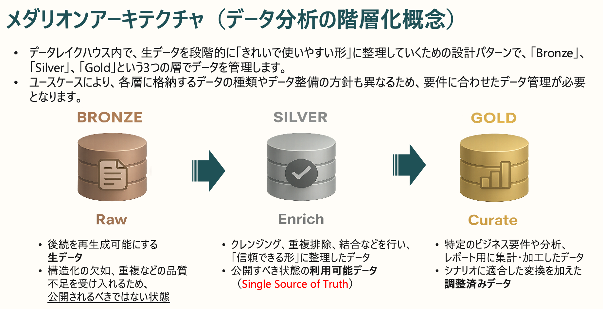
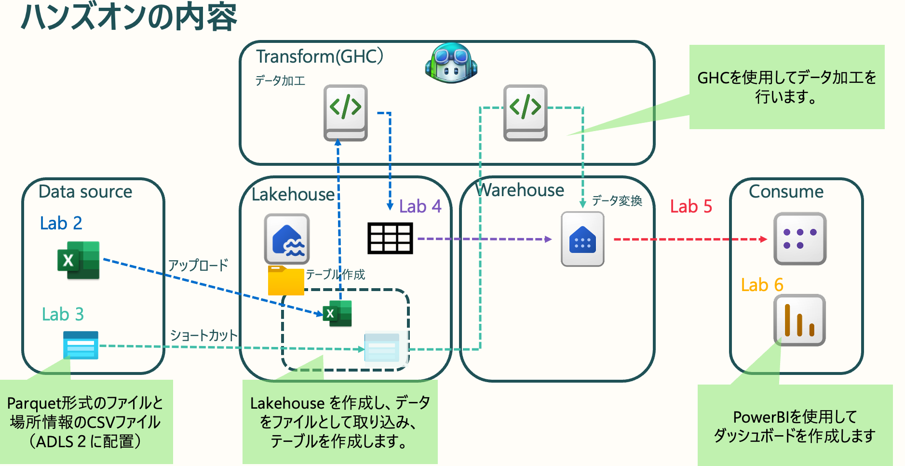

# Lab 02 — Lakehouse の作成・データ取り込み・変換（プロンプト駆動）

所要時間: 約 20 分
前提: [Lab 01](01-login-and-connect.md) 完了（自分の `student<番号>` ワークスペースに接続済み）

このラボでは、自分のワークスペースに **Lakehouse を作成**し、Parquet ファイルを
**Files にアップロード**したうえで、データ変換（列削除・null〔欠損値〕除去）を行い
**Delta テーブル**（更新・履歴に強いオープンなテーブル形式）**として保存**します。Lakehouse 作成・アップロード・PySpark 実行は
Copilot CLI が自動で行うので、あなたがやるのは**プロンプトで指示するだけ**です。

> 🤖 裏側では Fabric REST API（Lakehouse 作成）・OneLake DFS API（アップロード）・
> **Livy API**（Spark セッション）が使われます。

> 📦 取り込むサンプルデータは、Lab 00 で用意したこのハンズオンリポジトリの
> `data/green_tripdata_2026-04.parquet`（NYC グリーンタクシー風のサンプル・約 1.3 MB）です。


---

> 📖 **分からない用語があれば** [用語集（Glossary）](glossary.md) で確認できます（Lakehouse・Delta・Livy・セマンティックモデル など）。

## 📐 全体像: なぜデータを「加工」するのか

> Lab 02 から、いよいよ **データの加工** が始まります。まず全体像を押さえましょう。

### 生データはそのままでは使えない — だから「加工」する

実務のデータは、欠損・重複・型の不整合などで、**そのままでは“汚くて”分析に使えない**ことがほとんどです。
そこで、生データを段階的に「**きれいで使いやすい形**」へ整えていく設計パターンが
**メダリオンアーキテクチャ**（`Bronze` → `Silver` → `Gold` ＝ Raw → Enrich → Curate）です。



| 層 | 役割 |
|----|------|
| 🥉 **Bronze**（Raw） | 生データをそのまま受け入れる（重複・品質不足を許容／公開前の状態） |
| 🥈 **Silver**（Enrich） | クレンジング・重複排除・結合で「信頼できる形」に整える（Single Source of Truth＝信頼できる唯一の情報源） |
| 🥇 **Gold**（Curate） | 分析・レポート用に集計・加工した「調整済みデータ」 |

### このハンズオンの進み方

本ハンズオンは、厳密なメダリオンアーキテクチャ（Bronze/Silver/Gold の層分け）**そのものではありません**。
ですが同じ考え方で、**生データを綺麗にし、結合し、表示に必要な形へ加工**していきます。
具体的には、以下の図のステップ（Lab 02〜06）で進みます。



| ラボ | 何をするか |
|------|-----------|
| **Lab 02 / 03**（取り込み） | Parquet・CSV を Lakehouse に取り込みテーブル化（Lab 03 はショートカットで参照） |
| **Lab 04**（変換） | GitHub Copilot でデータを加工し、Warehouse にディメンション／ファクトを作成 |
| **Lab 05**（モデル） | 表示に必要な形へ整え、セマンティックモデルを構築 |
| **Lab 06**（表示） | Power BI ダッシュボードで可視化（Consume） |

> 💡 つまり「**生データ → 綺麗に整える → 結合・加工 → 表示**」という流れを、すべて **プロンプト駆動** で体験します
> （データの加工・変換は GitHub Copilot が自動で行います）。

---

## 2-1. Lakehouse を作成する

> 🗣️ **プロンプト**（`student<番号>` は自分のワークスペース名に置き換え）
> ```text
> student<番号> ワークスペースに taxi_lakehouse という名前の Lakehouse を作って。
> ```

🤖 **Copilot の動き**
- Fabric REST API（`POST /v1/workspaces/{id}/items`、`type: Lakehouse`）で Lakehouse を作成します。

✅ **期待する結果**
`taxi_lakehouse` が作成され、その Lakehouse ID が表示される。
ワークスペースのアイテム一覧にも `taxi_lakehouse`（と付随する SQL Endpoint）が追加されます。

---

## 2-2. サンプルデータを Files にアップロードする

> 🗣️ **プロンプト**
> ```text
> このリポジトリの data/green_tripdata_2026-04.parquet を、
> taxi_lakehouse の Files/raw/ にアップロードして。
> ```

🤖 **Copilot の動き**
- OneLake DFS API（`storage.azure.com` トークン）で、ローカルファイルを
  **作成 → 追記 → フラッシュ**の 3 ステップでアップロードします。

✅ **期待する結果**
`Files/raw/green_tripdata_2026-04.parquet` がアップロードされる。

---

## 2-3. Files 内のファイルを確認する

> 🗣️ **プロンプト**
> ```text
> taxi_lakehouse の Files にあるファイルを再帰的に一覧して。
> ```

🤖 **Copilot の動き**
- OneLake DFS API（`storage.azure.com` トークン）でファイルを再帰的に一覧します。

✅ **期待する結果**

```text
Files/raw/green_tripdata_2026-04.parquet  (約 1.3 MB)
```

> 📌 ファイルパスを確認し、次のステップで使います。

---

## 2-4. テーブルを作成する（変換あり）

> 🗣️ **プロンプト**
> ```text
> taxi_lakehouse の Files/raw/green_tripdata_2026-04.parquet を読み込んで、
> 以下の変換をしてから green_tripdata_2026 という Delta テーブルを作って。
>
> - ehail_fee 列を削除
> - passenger_count が null の行を削除
> ```

🤖 **Copilot の動き**
1. Livy セッションを作成（`idle` になるまで待機・約 30 秒）
2. 以下の PySpark コードを生成して実行:

```python
from pyspark.sql import functions as F

# Parquet を読み込み
df = spark.read.parquet("Files/raw/green_tripdata_2026-04.parquet")

# 1. ehail_fee 列を削除
df = df.drop("ehail_fee")

# 2. passenger_count が null の行を削除
df = df.filter(F.col("passenger_count").isNotNull())

# 3. Delta テーブルとして保存
df.write.format("delta").mode("overwrite").saveAsTable("green_tripdata_2026")
```

3. ステートメントの完了を待ち、結果を表示
4. Livy セッションを閉じる

✅ **期待する結果**

```text
Loaded rows: 44,238  columns: 21
Dropped: ehail_fee
Removed 6,290 rows with null passenger_count. Remaining: 37,948
Table green_tripdata_2026 created successfully!
```

| 処理 | 内容 |
|------|------|
| 元の行数 | 44,238 行 / 21 列 |
| `ehail_fee` 削除 | 列を削除 → 20 列 |
| null 行削除 | 6,290 行削除 → **37,948 行** |
| 書き込み形式 | Delta（Lakehouse の Tables セクションに表示） |

---

## 2-5. テーブルが作成されたか確認する

> 🗣️ **プロンプト**
> ```text
> taxi_lakehouse にある Delta テーブルを一覧して。
> green_tripdata_2026 があるか確認して。
> ```

🤖 **Copilot の動き**
- Fabric REST API でテーブル一覧を取得します。

✅ **期待する結果**

```text
## Tables
  - green_tripdata_2026
```

---

## 2-6. （応用）データを SQL で確認する

テーブルが作成されたら SQL Endpoint 経由でクエリできます。

> 🗣️ **プロンプト**
> ```text
> taxi_lakehouse の SQL Endpoint に接続して、
> green_tripdata_2026 の行数と passenger_count の null 件数を確認して。
> ```

✅ **期待する結果**

```sql
-- 行数
SELECT COUNT(*) AS total_rows FROM green_tripdata_2026;
-- → 37948

-- null 確認
SELECT COUNT(*) AS null_count FROM green_tripdata_2026 WHERE passenger_count IS NULL;
-- → 0
```

> 📌 `passenger_count IS NULL` が 0 件 → 変換が正しく適用されています。

> ⏳ **メモ（同期ラグ）**: テーブル作成直後は SQL Endpoint へのメタデータ同期に
> 数十秒〜数分かかることがあります。`Invalid object name 'green_tripdata_2026'` のような
> エラーが出たら、「taxi_lakehouse の SQL Endpoint のメタデータを更新して」で同期してから再実行してください。

---

## 🔍 （参考）裏側で実行される処理

プロンプト駆動でも、内部では次の流れが走っています。

```bash
FABRIC_TOKEN=$(az account get-access-token --resource https://api.fabric.microsoft.com --query accessToken -o tsv)
STORAGE_TOKEN=$(az account get-access-token --resource https://storage.azure.com --query accessToken -o tsv)

# 1. Lakehouse 作成（Fabric REST API）
curl -s -X POST -H "Authorization: Bearer $FABRIC_TOKEN" -H "Content-Type: application/json" \
  "https://api.fabric.microsoft.com/v1/workspaces/$WS_ID/items" \
  -d '{"displayName":"taxi_lakehouse","type":"Lakehouse"}'

# 2. データを Files にアップロード（OneLake DFS: 作成 → 追記 → フラッシュ）
ONELAKE="https://onelake.dfs.fabric.microsoft.com/$WS_ID/$LH_ID"
FILE="data/green_tripdata_2026-04.parquet"; SIZE=$(wc -c < "$FILE" | tr -d ' ')
curl -s -X PUT   "$ONELAKE/Files/raw/green_tripdata_2026-04.parquet?resource=file" \
  -H "Authorization: Bearer $STORAGE_TOKEN" -H "Content-Length: 0"
curl -s -X PATCH "$ONELAKE/Files/raw/green_tripdata_2026-04.parquet?action=append&position=0" \
  -H "Authorization: Bearer $STORAGE_TOKEN" --data-binary @"$FILE"
curl -s -X PATCH "$ONELAKE/Files/raw/green_tripdata_2026-04.parquet?action=flush&position=$SIZE" \
  -H "Authorization: Bearer $STORAGE_TOKEN" -H "Content-Length: 0"

# 3. ファイル一覧（OneLake DFS）
curl -s -H "Authorization: Bearer $STORAGE_TOKEN" \
  "$ONELAKE/Files?resource=filesystem&recursive=true"

# 4. Livy セッション作成
curl -s -X POST -H "Authorization: Bearer $FABRIC_TOKEN" -H "Content-Type: application/json" \
  "https://api.fabric.microsoft.com/v1/workspaces/$WS_ID/lakehouses/$LH_ID/livyapi/versions/2023-12-01/sessions" \
  -d '{"name":"my-session"}'

# 5. ステートメント送信 → ポーリング → セッション削除
```

---

## ✅ チェックポイント

- [ ] プロンプトで `taxi_lakehouse` を作成できた
- [ ] サンプル parquet を `Files/raw/` にアップロードできた
- [ ] プロンプトで変換・テーブル作成が完了した
- [ ] テーブル一覧に `green_tripdata_2026` が表示された
- [ ] 行数が 37,948、`passenger_count` の null が 0 件

---

## 🧹 トラブルシュート

| 症状 | プロンプト例 / 対処 |
|------|---------------------|
| アップロードが失敗する | 「data/green_tripdata_2026-04.parquet のパスを確認して、taxi_lakehouse の Files/raw にもう一度アップロードして」 |
| ファイルが見つからない | 「taxi_lakehouse の Files を再帰的に一覧して」でパスを再確認 |
| Livy セッション作成が失敗する | 「もう一度 Livy セッションを作り直して」 |
| セッションが `starting` のまま | 少し待ってから「セッションの状態を確認して」→ idle になってから再実行 |
| `ehail_fee` 列が存在しないエラー | 列名のスペルをファイルの実際の列名に合わせる（「カラム一覧を見せて」で確認） |
| テーブルが一覧に出ない | 「taxi_lakehouse の SQL Endpoint のメタデータを更新して」で同期 |

---

次は **Lab 03 — ADLS Gen2 + OneLake ショートカット**（[03-adls-shortcut.md](03-adls-shortcut.md)）に進みます。
